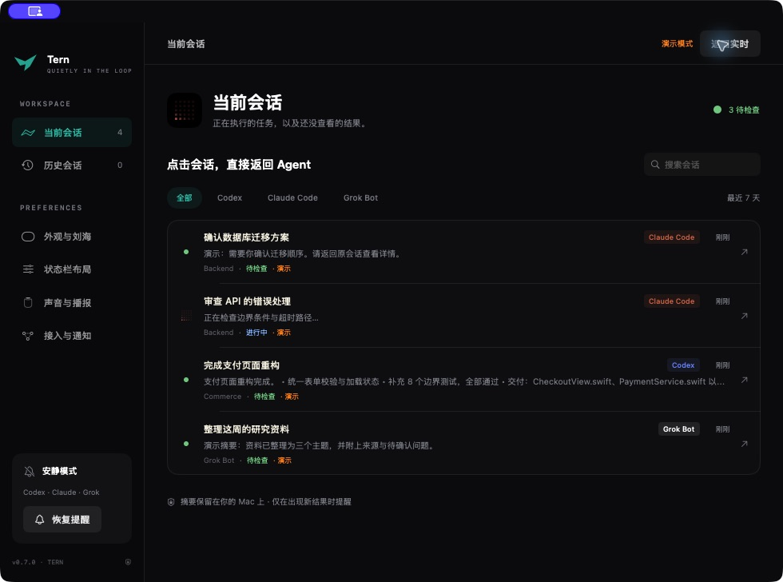

<p align="center"></p>
<h1 align="center">Tern</h1>
<p align="center">A quiet home for your coding agents.</p>

Tern is a native macOS status bar and notch companion for Codex, Claude Code, and Grok Bot. See what is running, notice results you have not reviewed, and jump back to the original session.

[中文使用说明](docs/README.zh-CN.md) · [Privacy](PRIVACY.md) · [Integrations](docs/INTEGRATIONS.md) · [Release guide](docs/RELEASING.md)

## What it does

- Opens on hover. A completed task updates the compact indicator without expanding the notch or stealing focus.
- Separates **current** sessions (running or awaiting review) from **history**. Clicking a row opens the original agent session.
- Offers independent, draggable status-bar layouts: **120–240 pt idle**, **240–360 pt active**. Text and counts never resize the bar. Camera cutouts reserve additional space.
- Uses a softly drifting, irregular dot field while idle and provider-colored streams while agents are running. Honors Reduce Motion.
- Keeps green review indicators until source-app evidence confirms the corresponding delivery was viewed.
- Supports optional system notifications, custom sounds, local speech, and macOS-connected AirPlay/HomePod outputs.
- Processes summaries locally. No Tern account, analytics service, or model API key is required.



The interface currently uses Simplified Chinese. The app is independent of OpenAI, Anthropic, and the makers of Grok Bot.

## Build and run

Requires **macOS 14 or later**, Xcode or compatible command-line tools with **Swift 5.10+**, and Python 3 for the repository audit. SSH monitoring additionally requires Python 3 on the selected host.

```sh
swift test
./scripts/build.sh
open build/Tern.app
```

Useful options:

```sh
./scripts/run.sh --demo        # clearly labeled synthetic demo
./scripts/run.sh --background  # no dashboard window at launch
build/Tern.app/Contents/MacOS/Tern --inspect  # source health/counts, no prompts or replies
./scripts/package-release.sh --preview      # universal local preview ZIP + SHA-256
```

The default build is **ad-hoc signed for local development**, not notarized. A preview ZIP is not a verified public distribution. Follow the [release guide](docs/RELEASING.md) for Developer ID signing, notarization, and the public-release verification gate. Do not disable Gatekeeper to distribute a preview.

## Monitoring coverage

| Source | Observation | Limits |
| --- | --- | --- |
| Codex local | Incremental rollout logs and desktop read metadata | Recent seven days, up to 100 log files |
| Claude Code local | JSONL transcripts, desktop focus metadata | Explicit terminal events; tool output is not a completion |
| Codex / Claude SSH | Read-only, bounded probe of agent-configured SSH hosts | Up to four saved aliases; requires existing SSH access and remote Python 3 |
| Claude cloud / Remote Control | Desktop session cache, matched to execution logs using explicit bridge IDs | Unmapped cloud sessions depend on the desktop cache refreshing |
| Codex cloud | Existing CLI login and `codex cloud list --json` | Latest 20 tasks; no task is submitted by Tern |
| Grok Bot | Desktop roster and transcript caches | Experimental; a reply does not prove an entire background task is finished |

Local files refresh approximately every two seconds; SSH/cloud queries run independently approximately every 15 seconds. Sleep, disconnected hosts, missing files, and stale caches can delay updates. Tern never treats silence or connection failure as success.

Read confirmation is an integration signal, not proof that a human understood a result. Unsupported cache formats and plain SSH terminal sessions can lack reliable read receipts, in which case review indicators remain. See the full [integration notes](docs/INTEGRATIONS.md).

## Settings and upgrades

The two layout profiles, theme swatches, audio settings, review inbox and acknowledged revisions persist locally. Muting suppresses sound and system notifications without discarding review state.

Tern retains the prototype's bundle identifier, `dev.bolin.agent-island`, so existing preferences and notification permissions survive the rename. Newly imported sounds and SSH resume scripts live in `~/Library/Application Support/Tern`. Existing selected custom sounds continue to work at their saved paths.

## Repository

```text
Sources/Tern/          AppKit panels, SwiftUI views, settings, notifications and audio
Sources/TernCore/      Models, parsers, monitor adapters, receipts, geometry and motion
Tests/                 Synthetic fixtures and temporary-directory tests
Resources/             Info.plist, privacy manifest, original brand artwork
scripts/               Build, audit, package, sign and verify
.github/               macOS CI and contribution templates
docs/                   Architecture, integration contracts and release instructions
```

There are no third-party Swift package dependencies. Public screenshots must use demo data; do not upload local agent logs, caches, credentials, or real-session screenshots to issues.

## License and credits

MIT. The Tern folded-wing artwork is original. Provider names identify integrations; their trademarks belong to their owners. Official provider logos, fonts, application assets and source code are not redistributed. [Brand provenance and design references](docs/BRAND.md).
